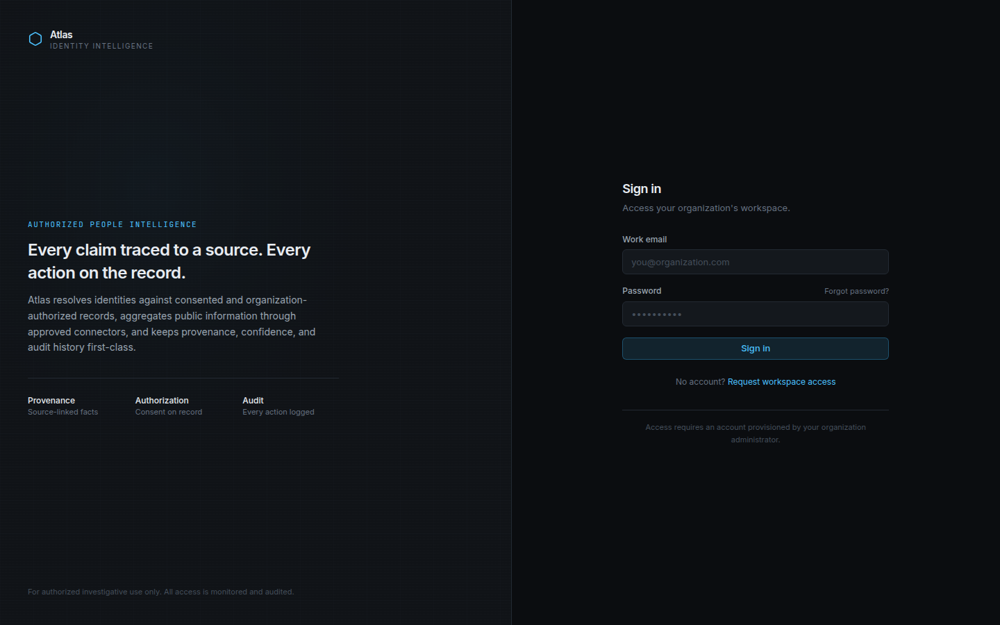
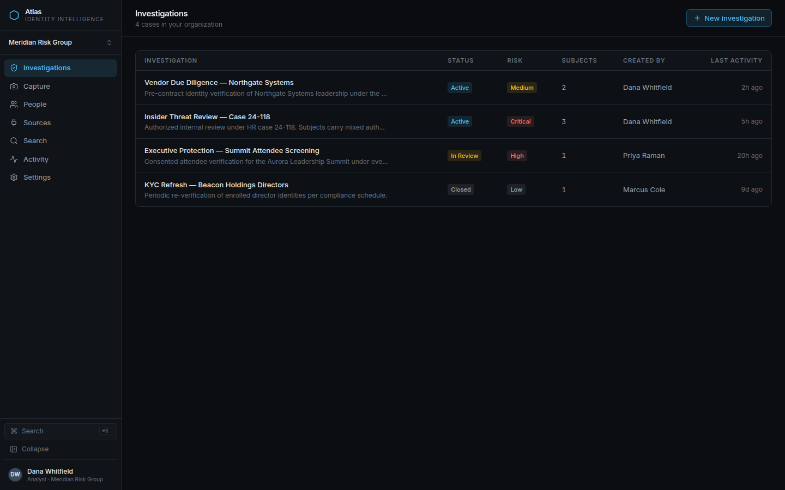
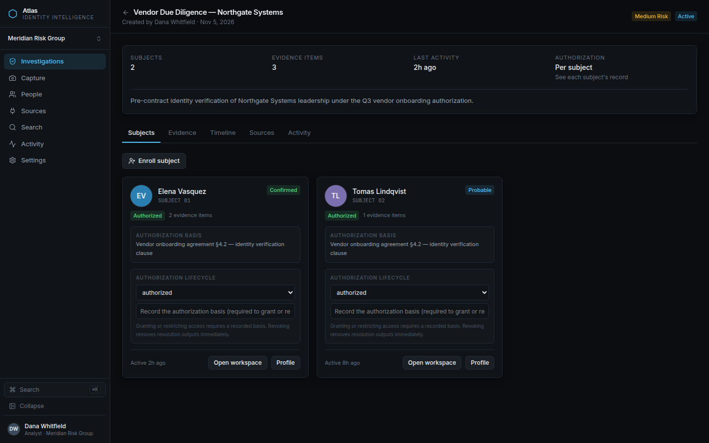
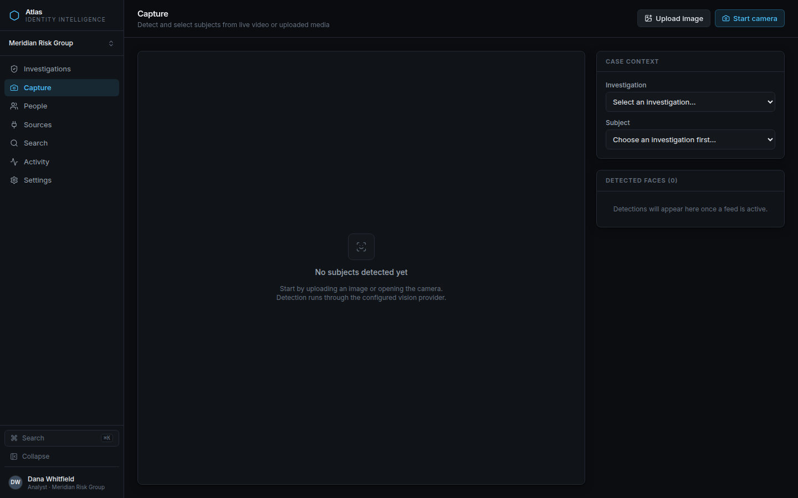
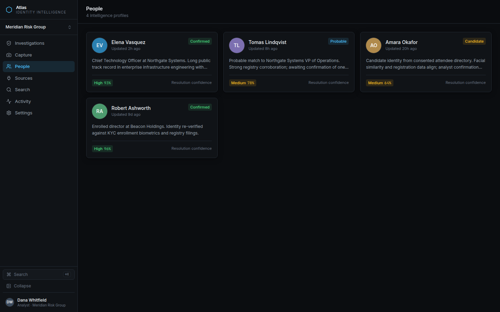
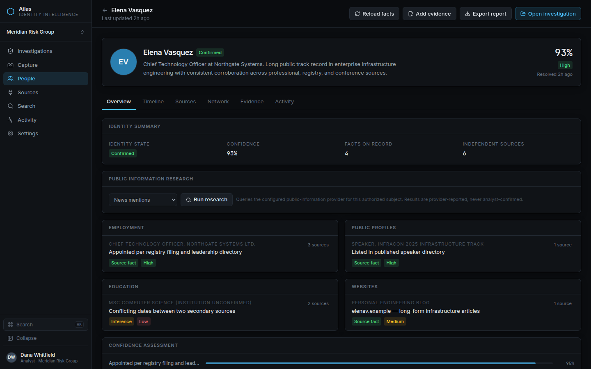
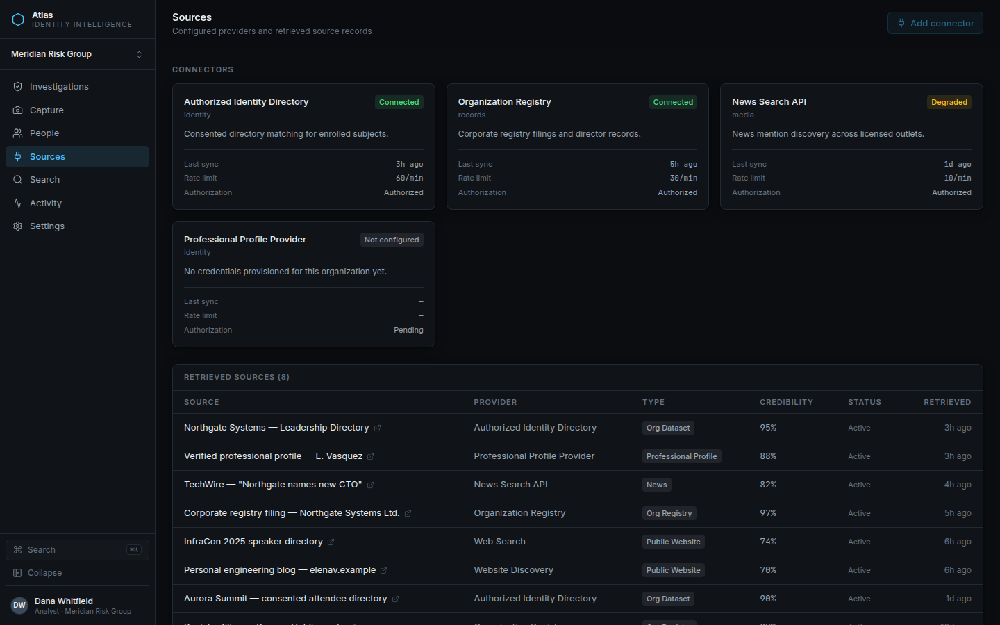
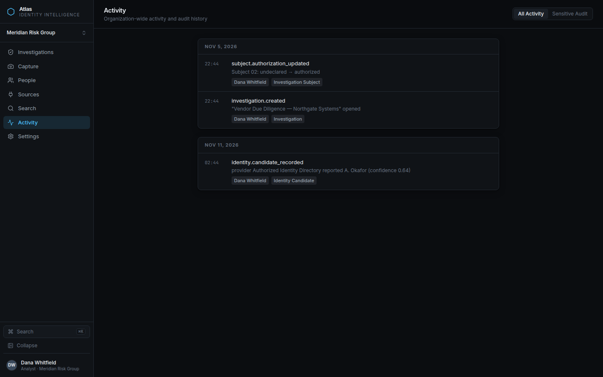
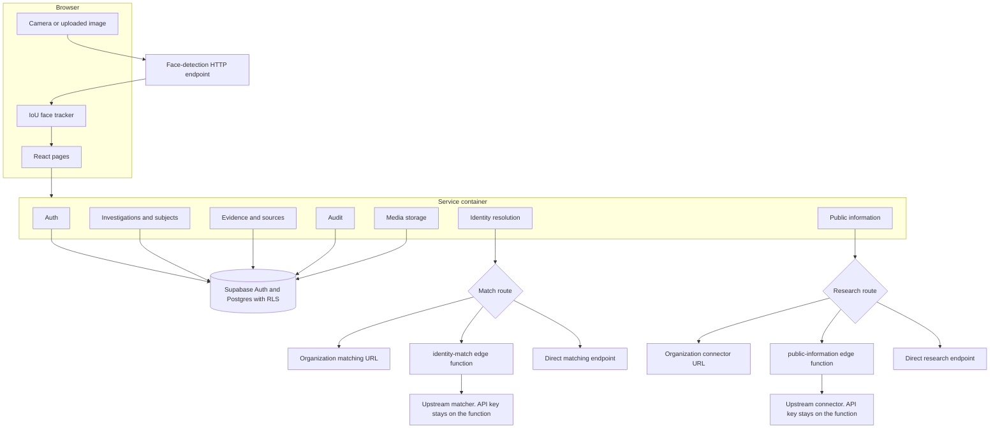

# Atlas Intelligence

Analyst workspace for authorized face capture and identity research: detect a face in a camera frame or upload, track it in the browser, and match it only against records the organization has authorized — with every claim kept traceable to a source.

Presented on [Dimitris Vogiatzis's portfolio](https://portfolionew-nine-woad.vercel.app/).

## Screenshots

These images are from a local development run with `VITE_ATLAS_DEMO_FIXTURES=true`. The people, organizations, and sources are fictional fixtures in `dev/fixtures`. Avatars are colored initials. There are no photographs of real people.

| | |
| --- | --- |
|  |  |
| Sign in | Investigations |
|  |  |
| Investigation detail | Capture |
|  |  |
| People | Profile |
|  |  |
| Sources | Activity |

## Features

What the application code actually implements:

- **Investigations.** List and create cases, enroll subjects, and open a per-subject workspace.
- **Authorization lifecycle.** Each subject moves through `undeclared`, `authorized`, `restricted`, and `revoked`. Granting or restricting access requires a recorded basis. Identity matching refuses any subject that is not `authorized`.
- **Capture.** Start the browser camera or upload an image. Frames are sent to a configured face-detection HTTP endpoint. Returned boxes are tracked in the browser with IoU association and exponential smoothing (`src/services/faceTracking.ts`). This repository does not ship an on-device detector, an embedding model, or a local face gallery.
- **Identity matching.** For an authorized subject, the selected frame and face box are sent to a matcher. Precedence is the organization's credentialless `matching_provider_url`, then the `identity-match` edge-function proxy, then the legacy direct endpoint. Analysts confirm or reject candidates. Raw embedding vectors are not handled in the frontend; the schema stores an opaque `embedding_reference`.
- **People profiles.** Facts, confidence, evidence, a timeline, and a relationship graph. Facts keep origin and source references.
- **Public-information research.** A profile can query a configured connector (organization endpoint, `public-information` proxy, or direct endpoint). The request sends the contract version, a correlation id, and the person's name. Results are stored as provider-reported sources and facts.
- **Sources and audit.** Connectors and retrieved sources are listed. Sensitive actions append audit events; the database migrations reject updates and deletes of those events.
- **Honest empty states.** With no Supabase project and demo fixtures off, services throw "provider not configured" instead of inventing detections or matches.

A few visible controls have no handler, including "Forgot password?", "Add evidence", "Export report", and the privacy actions on Settings. They are not product features.

## Tech stack

From `package.json` and the code that imports it:

- React 19 and React DOM
- TypeScript (strict project references) and Vite
- Tailwind CSS 4
- React Router 7
- Zod for service input and output schemas
- Supabase JS client for Auth, Postgres, and Storage
- Supabase Edge Functions (`supabase/functions/identity-match`, `supabase/functions/public-information`) as server-side proxies that keep provider API keys out of the browser
- Lucide icons
- Vitest and Testing Library for unit tests; Playwright for hosted end-to-end tests
- oxlint

Postgres schema and row-level security live in `supabase/migrations/` (`0001` through `0007`).

## Architecture

The UI talks to service interfaces. `src/services/container.ts` picks one mode per session:

- `api` when `VITE_SUPABASE_URL` and `VITE_SUPABASE_ANON_KEY` are set
- `demo` only in a development build with `VITE_ATLAS_DEMO_FIXTURES=true` (fixtures under `dev/` are not imported by production code)
- `unconfigured` otherwise



Detection and matching providers are external. This repo validates their responses and records provenance. It does not contain the vision model or the gallery index.

## Local setup

```sh
npm install
cp .env.example .env
npm run dev
```

The dev server prints a local URL. With the example file left empty, sign-in stays unavailable and data pages show the unconfigured state.

To click through the interface against fictional in-memory data, set this in `.env` and restart the dev server:

```sh
VITE_ATLAS_DEMO_FIXTURES=true
```

Demo mode accepts any well-formed email and password. It is ignored in production builds (`npm run build`).

To run against a real Supabase project, fill `VITE_SUPABASE_URL` and `VITE_SUPABASE_ANON_KEY`, then apply the SQL in `supabase/migrations/` in filename order (`0001_init.sql` through `0007_public_information_ingestion.sql`). The Supabase CLI command for a linked project is `supabase db push`. There is no `supabase/config.toml` in this repository.

Optional provider URLs are listed in `.env.example`. Leave them empty until you have an endpoint. Do not put provider API keys in any `VITE_` variable; those values are compiled into the public JavaScript bundle. Proxy keys belong in the edge function environment (names below).

### Scripts

| Command | Purpose |
| --- | --- |
| `npm run dev` | Vite dev server |
| `npm run build` | Typecheck, production build, then a bundle secret scan |
| `npm run preview` | Serve the production build |
| `npm run lint` | oxlint |
| `npm test` | Vitest once |
| `npm run test:watch` | Vitest watch mode |
| `npm run test:e2e` | Playwright. Skips hosted suites when E2E credentials are absent |
| `npm run e2e:schema-verify` | Check a hosted database against the migrations |
| `npm run e2e:migrations` | Apply migrations when explicitly allowed |

## Environment variables

Names only. Copy `.env.example` to `.env` and fill values locally. `.env` files are gitignored. `.env.e2e.example` lists the runner-only names used by Playwright.

Browser configuration (`.env.example`):

| Name | Role |
| --- | --- |
| `VITE_SUPABASE_URL` | Supabase project URL |
| `VITE_SUPABASE_ANON_KEY` | Supabase anon key |
| `VITE_ATLAS_FACE_DETECTION_ENDPOINT` | Optional face-detection HTTP endpoint |
| `VITE_ATLAS_IDENTITY_MATCHING_ENDPOINT` | Optional credentialless direct matching endpoint |
| `VITE_ATLAS_IDENTITY_MATCHING_PROXY_ENDPOINT` | Optional matching proxy. The browser sends the user JWT |
| `VITE_ATLAS_PUBLIC_INFORMATION_ENDPOINT` | Optional credentialless direct research endpoint |
| `VITE_ATLAS_PUBLIC_INFORMATION_PROXY_ENDPOINT` | Optional research proxy |
| `VITE_ATLAS_DEMO_FIXTURES` | Development only. Set to `true` to load fictional fixtures |

Edge function secrets (set with `supabase secrets set`, never in the client):

| Name | Role |
| --- | --- |
| `IDENTITY_MATCHING_PROVIDER_URL` | Upstream matcher URL |
| `IDENTITY_MATCHING_PROVIDER_API_KEY` | Upstream matcher credential |
| `PUBLIC_INFORMATION_PROVIDER_URL` | Upstream research URL |
| `PUBLIC_INFORMATION_PROVIDER_API_KEY` | Upstream research credential |

Hosted end-to-end runner (`.env.e2e.example`). The service-role key and management token must stay on the runner:

| Name |
| --- |
| `ATLAS_E2E_SUPABASE_URL` |
| `ATLAS_E2E_SUPABASE_ANON_KEY` |
| `ATLAS_E2E_PASSWORD` |
| `ATLAS_E2E_SERVICE_ROLE_KEY` |
| `ATLAS_E2E_ACCESS_TOKEN` |
| `ATLAS_E2E_ALLOW_MIGRATIONS` |

## Scope

The matching and research paths are built for consented or organization-authorized records and for connectors the deployment configures. Candidate search does not run unless the subject's authorization state is `authorized`. The repository does not include a covert identification pipeline, a scraped private-profile crawler, or a way to bypass provider authentication.
